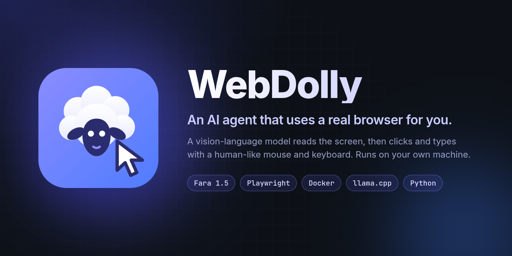

<p align="center">
  
</p>

<p align="center">
  <a href="LICENSE"></a>
  
  
  
  
</p>

WebDolly is an agent that uses a real browser for you. A vision-language model
([Fara 1.5](https://huggingface.co/microsoft/Fara1.5-27B)) looks at screenshots
and decides where to click and what to type. You describe who you are (context)
and what to do (task) in a small web panel, and the agent does it.

The task is free text, so it can drive any website. What the agent knows about a
particular site lives in a **site profile** (see [docs/site-profiles.md](docs/site-profiles.md)):
with the default `generic` profile it is a plain browser agent, and a profile for
a specific platform adds what working on it takes: its task list, how a task is
launched and handed back, completion codes, time limits and the rules to follow
there. One such profile is included; the guide explains how to customise it or add
your own.

Everything runs on your own machine: the model, the browser and the control panel.
The model can also be a remote API instead, in which case no GPU is needed.

```
 Your PC (Python)                       Docker
 +--------------------------+           +------------------------------+
 | gui_server.py  :8766     |  HTTP     | fara-test         :8090      |
 |   agent loop, Playwright |---------->|   llama.cpp + Fara 1.5       |
 |   Telegram bot (optional)|           +------------------------------+
 |                          |  CDP      | fara-browser-pw   :9333      |
 |                          |---------->|   Chromium (kiosk) on Xvfb   |
 +--------------------------+           +------------------------------+
```

## What you need

| | Windows 11 | Linux |
|---|---|---|
| Docker | [Docker Desktop](https://www.docker.com/products/docker-desktop/) with the WSL2 backend | Docker Engine |
| GPU (local model) | NVIDIA, up-to-date driver (Docker Desktop passes the GPU through WSL2) | NVIDIA + [Container Toolkit](https://docs.nvidia.com/datacenter/cloud-native/container-toolkit/) |
| Python | 3.12 | 3.12 |
| Git | [Git for Windows](https://git-scm.com/download/win) | git |

Hardware for running the model locally:

| Model | File size | VRAM | Notes |
|---|---|---|---|
| Fara 1.5 **27B** Q4_K_M (recommended) | 17.5 GB | 24 GB (uses about 21 GB) | reliable on real surveys |
| Fara 1.5 **9B** Q8_0 | about 9.5 GB | 12 GB | twice as fast, misses small buttons, fails complex surveys |

You also need about 40 GB of free disk and 16 GB of RAM or more.

No GPU? Use a hosted vision model instead and skip the model download: set
`FARA_URL`, `FARA_MODEL` and `FARA_API_KEY` (see [Configuration](#configuration)).

## Setup

### 1. Get the code

```bash
git clone https://github.com/rickardof/WebDolly.git
cd WebDolly
```

On Windows keep the path short (for example `C:\Users\you\WebDolly`): very long
paths make Git and Docker fail with "Filename too long".

### 2. Download the model

Create the folder `models/` in the project and put two files in it, the model and
its vision projector (`mmproj`). Both come from
[bartowski/Fara1.5-27B-GGUF](https://huggingface.co/bartowski/Fara1.5-27B-GGUF):

- `Fara1.5-27B-Q4_K_M.gguf`
- `mmproj-Fara1.5-27B-bf16.gguf`

For the 9B model use [bartowski/Fara1.5-9B-GGUF](https://huggingface.co/bartowski/Fara1.5-9B-GGUF)
(model plus its own `mmproj`). Skip this step if you use a hosted model.

### 3. Run the setup

This creates the Python environment, builds the Docker images and starts the
containers. It is safe to run again.

**Windows** (PowerShell, from the project folder):

```powershell
powershell -ExecutionPolicy Bypass -File scripts\windows\setup.ps1
```

**Linux:**

```bash
./scripts/setup.sh
```

On Linux, if your projector is the bf16 one, tell the script first:
`FARA_LOCAL_MMPROJ=mmproj-Fara1.5-27B-bf16.gguf ./scripts/setup.sh`.

Options for `setup.ps1`: `-Model <file>` and `-Mmproj <file>` for other model files,
`-SkipModel` if you use a hosted model.

## Run it

**Windows:**

```powershell
powershell -ExecutionPolicy Bypass -File scripts\windows\start.ps1
```

Useful flags: `-KeepAwake` (stop the PC from sleeping while the agent runs),
`-NoModel` (hosted model), `-NoBrowser` (do not open the panel).

**Linux:**

```bash
./scripts/start_gui_pw.sh
```

The panel opens at <http://127.0.0.1:8766>. It only listens on your own machine.
The model needs one to two minutes to load after a cold start.

To stop everything: `scripts\windows\stop.ps1` on Windows, or
`docker stop fara-test fara-browser-pw` plus closing the Python process on Linux.
To restart only the panel after changing the code: `scripts\windows\restart.ps1`
or `./scripts/restart.sh`. Containers and browser logins are kept.

## Use it

1. **Log in to your sites once.** The browser is a kiosk without an address bar,
   so in the panel use *Manual control* (type a URL, click, type text) to open the
   site and sign in. The login is saved in the browser profile (`var/profiles/pw/`)
   and survives restarts.
2. In *Settings*, write the **Context** (who you are: age, job, what the agent may
   say about you) and the **Task** (what to do, in plain language).
3. Press **Start**. The *Activity* tab shows what the agent thinks and does, live.
   **Stop** halts it immediately. You can also send it an extra instruction while
   it runs.

Main settings:

| Setting | What it does |
|---|---|
| Presets | save and reload a combination of settings |
| Loop + pause | after a cycle, wait N seconds and start again (for example to keep checking for new studies) |
| Batch fill | on long forms, decide all answers in one model call instead of field by field |
| Go to URL | page to open before starting |
| Site profile | which site profile the run uses; *automatico* picks it from the URL (see [docs/site-profiles.md](docs/site-profiles.md)) |
| Max steps | step limit per cycle |

Optional files (copy the `.example` next to each one; they are git-ignored because
they hold personal data):

```
agent/identity.json.example      ->  agent/identity.json       fields the agent may copy, e.g. an ID
agent/telegram_config.py.example ->  agent/telegram_config.py  Telegram bot, see below
```

### Site profiles

A site profile is what the agent knows about one website: its pages, its
buttons, the rules the model follows there, and the behaviours the loop runs
with on it (for example the timing and hand-back rules of a task platform).
Two come with the code: `generic` (any website, no special rules) and one for
an online research-study platform.
The full guide is
[docs/site-profiles.md](docs/site-profiles.md):

- [choose the profile](docs/site-profiles.md#which-profile-is-used): the
  *Profilo del sito* menu, `FARA_SITE`, or automatic from the URL;
- [what the generic profile does](docs/site-profiles.md#what-the-generic-profile-changes);
- [customise an included profile](docs/site-profiles.md#customising-an-included-profile):
  the rules the model follows, the domains and URLs it uses;
- [add a profile for another site](docs/site-profiles.md#adding-a-platform);
- [write a behaviour](docs/site-profiles.md#writing-a-behaviour) when a site
  needs the loop to act differently.

### Telegram (optional)

1. In Telegram, talk to **@BotFather**, send `/newbot` and copy the token.
2. Send any message to your new bot, then open
   `https://api.telegram.org/bot<TOKEN>/getUpdates` and copy `message.chat.id`.
3. Put both values in `agent/telegram_config.py` and restart the panel.

Then message the bot: `/start`, `/stop`, `/status` (screenshot and state),
`/inject <text>`, `/help`. The bot only answers your chat id. Keep the token secret:
it is enough to drive the agent. Without the file, Telegram is silently skipped.

## Configuration

Set environment variables before starting (everything has a default).

| Variable | Default | Meaning |
|---|---|---|
| `FARA_URL` | `http://127.0.0.1:8090/v1/chat/completions` | model endpoint (OpenAI-compatible) |
| `FARA_MODEL` | `Fara1.5-27B-Q4_K_M.gguf` | model name sent in requests |
| `FARA_API_KEY` | empty | set it to use a hosted model (adds the auth header and HTTPS) |
| `FARA_PORT` | `8766` | panel port (Windows scripts) |
| `FARA_SITE` | `auto` | site profile by name (see the guide), or `auto` to pick it per run |
| `FARA_ENABLE_THINKING` | `0` | `1` keeps the model's thinking (worse clicks on the 9B) |
| `FARA_BRIDGE_WATCHDOG` | `1` | `0` disables the auto-restart described below |
| `FARA_BRIDGE_WEDGE_SECS` | `240` | how long the browser bridge may be stuck before the watchdog acts |

The full list, plus the agent's safety rules, speed modes, the HTTP API, the
dashboard, logs and cloud deployment, is in [docs/reference.it.md](docs/reference.it.md)
(Italian). Variables that belong to one site profile are listed in
[docs/site-profiles.md](docs/site-profiles.md).

## Troubleshooting

**`BrowserStateError ... no URL for the active tab`, every cycle fails.**
The browser bridge got stuck (seen on Windows after a page reload: the Playwright
driver died and the Python thread spun at 100% CPU). Restart the panel:
`scripts\windows\restart.ps1 -ResumeLast` restarts it and starts your last run
again. A watchdog does this by itself on Windows after 240 s of being stuck, and
sends you a Telegram message.

**A container exits right away with `exec /entrypoint-pw.sh: no such file`.**
The shell scripts were checked out with Windows line endings. The repo's
`.gitattributes` prevents it; if you cloned before that, run
`git config core.autocrlf input`, re-checkout the files and rebuild the images.

**`UnicodeDecodeError: 'charmap' codec ...` when running tests or scripts.**
Run Python in UTF-8 mode: `set PYTHONUTF8=1` (cmd) or `$env:PYTHONUTF8='1'`
(PowerShell). `start.ps1` already does it for the panel.

**The model is slow (under about 10 tokens/s).**
Check that it runs on the GPU: `nvidia-smi` should show about 20 GB used and high
utilisation while it answers. On laptops, plug in the charger and use a
high-performance power mode. Restarting the model container often helps:
`docker restart fara-test`.

**The model container starts but `/health` returns 503.**
It is still loading the model. Wait one or two minutes.

**The PC goes to sleep during a run.** Start with `start.ps1 -KeepAwake`.

## Tests

Offline tests (no browser, no model, safe to run any time):

```powershell
$env:PYTHONUTF8 = '1'
venv_pw\Scripts\python.exe tests\context_trim_test.py
venv_pw\Scripts\python.exe tests\submissions_parse_test.py
venv_pw\Scripts\python.exe tests\qc_flag_test.py
venv_pw\Scripts\python.exe tests\run_counting_test.py
venv_pw\Scripts\python.exe scripts\tools\test_harness_guards.py
venv_pw\Scripts\python.exe tests\site_profiles_test.py
```

On Linux use `venv_pw/bin/python`. The other scripts in `agent/` and `tests/`
(`tests_resilience.py`, `humanization_e2e.py`, benchmarks) need the containers.
**Do not run them while a real run is in progress**: they use the same browser.

## Project layout

```
agent/            agent code: agent_core.py (the generic loop), pw_bridge.py
                  (Playwright bridge), form_fill_pw.py (batch fill), gui_server.py and
                  gui_index.html (the panel)
agent/sites/      site profiles: base.py (generic) and one directory per platform
agent/behaviors/  rule sets a profile plugs into the loop (task_platform.py)
docker/           images: browser (Chromium + Xvfb + xdotool) and browser-pw (+ socat)
scripts/          setup, start, stop and restart; windows/ has the PowerShell versions,
                  cloud/ the VM deployment
fixtures/         test pages
tests/            offline and end-to-end tests
bench/            model benchmarks
docs/             site profiles guide, detailed reference (Italian)
models/           GGUF model files (not in git)
var/              logs, screenshots and the browser profile (not in git, personal data)
```

Never share `var/profiles/` (cookies and logins) or `agent/telegram_config.py`.

## Responsible use

This tool automates a browser on your account. Check the terms of service of every
site you point it at, and do not use it where automation is forbidden. You are
responsible for what it does with your accounts.

## License

[MIT](LICENSE). The model weights are not part of this repository: Fara 1.5 is
distributed by its authors under its own license.
